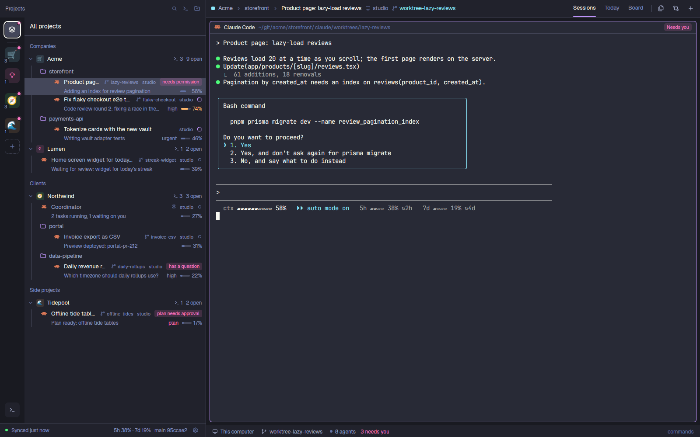
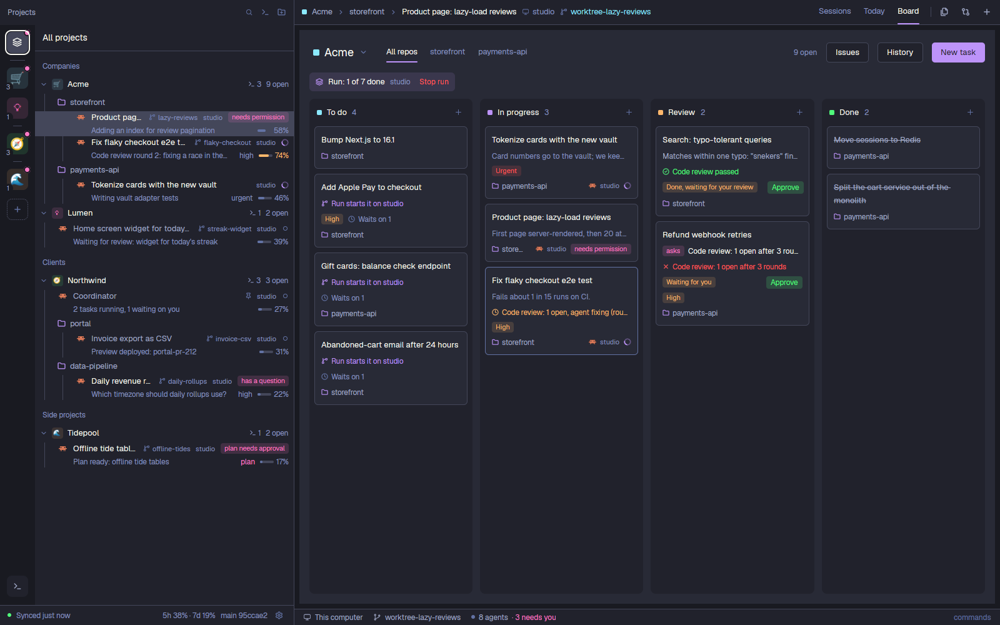
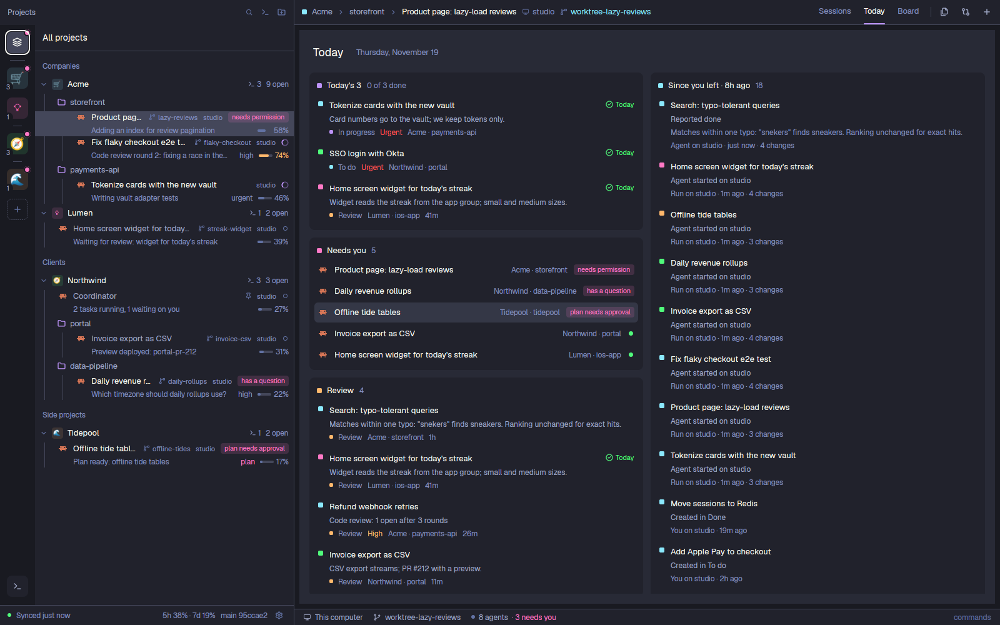
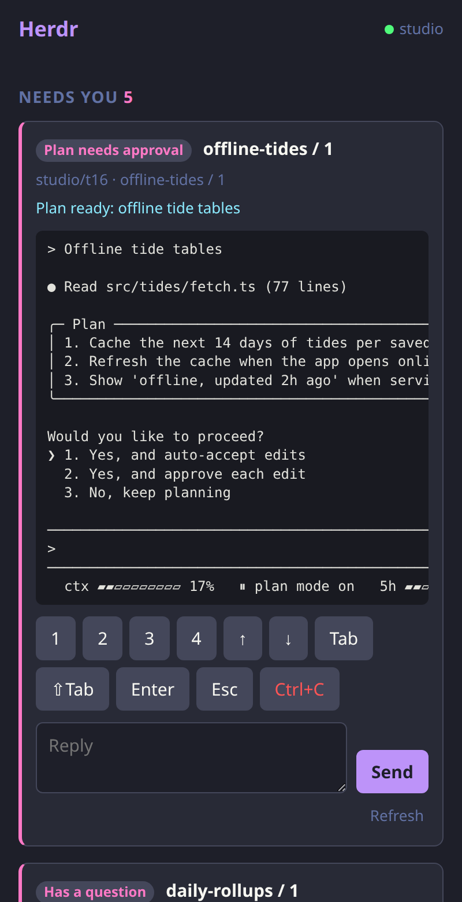

# herdr-corral

A project-first workspace for [Herdr](https://herdr.dev) when you run many coding agents
(Claude Code, Codex) across many repos and more than one machine. It groups every agent
session under the project it works on, gives each project a task board shared by all your
machines, and starts unattended agents on tasks, each in its own git worktree, with an
optional code-review pass before a card reaches you.

Every session sits under its project and repo, with what the agent says it's doing, its
worktree, its context use and a badge when it needs you: `needs permission`, `has a
question`, `plan needs approval`. The coordinator stays pinned at the top of its project.

Each project has a board shared by all your machines. Run a chain of tasks and each one
starts in its own worktree as the tasks it waits on finish. Cards show their agent's live
state, code review results and what's waiting for your approval.

Today reads across every project: the three tasks you picked for the day, every agent that
needs you, everything waiting for your review, and what changed while you were away.

With the optional Pi, a page on your tailnet lists the agents that need you, with the last
lines of their screen, keys for their prompt and a reply box, and your phone gets a push
when one blocks or finishes while you're away.

The screenshots use sample projects and agents.

 

What's in it:

- The `projects` mod: a sidebar of projects > repos > sessions with live agent status,
  a board per project (To do, In progress, Review, Done) with dependencies and runs, a
  Today view, a coordinator agent per project, and GitHub issues on the board.
- `hb`, the CLI agents report with (`hb done`, `hb ask`, `hb note`, `hb add`).
- A run guard for unattended agents: a Claude Code hook that refuses deploys, force
  pushes, destructive SQL and writes outside the task's worktree.
- Cleanup of merged worktrees, branches and Neon branches, per task and nightly.
- Handoff, which moves a running Claude Code session and its conversation to another machine.
- `herdr-pi` (optional), an always-on service for phone alerts, a tailnet web page
  to answer agents and approve permission prompts, a nightly cleanup, backups and a
  daily digest, next to the board's Postgres.

## Stack

Required:

- [Herdr](https://herdr.dev) on every machine: the desktop app (`herdr-app`), whose mods
  this repo adds, and herdr-core (`hc`), which runs the terminals and agents and links the
  machines.
- Postgres for the shared board, reached over HTTP: [Neon](https://neon.tech) natively,
  any other Postgres through `herdr-sql`, the gateway in `pi/`
  ([docs/database.md](docs/database.md)).
- [Claude Code](https://claude.com/claude-code) for task agents, the run guard and
  code review (hooks in `~/.claude/settings.json`). Codex works for sessions started by hand.
- git and GitHub, with the [`gh`](https://cli.github.com) CLI: worktrees per task, PR and
  CI badges, issues on the board, repo creation.
- Python 3.10+ and [uv](https://docs.astral.sh/uv/) for `hb`, the hooks and the scripts.

Recommended:

- [Tailscale](https://tailscale.com) to link the machines: SSH between them for
  herdr-core and deploys, MagicDNS names, and HTTPS for the board and the web page
  without exposing anything to the internet.
- An always-on box with Docker (a Raspberry Pi is plenty) for the board's Postgres and,
  optionally, the `herdr-pi` service: phone alerts through self-hosted
  [ntfy](https://ntfy.sh), the web page, backups and the digest.

Optional: [`neonctl`](https://neon.tech/docs/reference/neon-cli), so cleanup also removes
Neon database branches your projects' agents create.

The mod is JavaScript for Herdr's runtime; the service and the scripts are Python (FastAPI,
psycopg, Pydantic); deploys are bash and rsync over SSH.

To install, follow [INSTALL.md](INSTALL.md). The examples below use two machines named `desk` (Linux) and `laptop` (macOS); yours come
from `~/.config/herdr-board/config.json`.

## How it fits together

- Herdr window (one per machine, layout `projects-dracula`): the `projects` mod draws the sidebar (a rail of project marks, split by short rules into companies, clients and side projects, beside a project > repo > session tree; a project's mark and tree row show its session count, and the row's `N open` counts its tasks that aren't Done), the board, Today and the top bar. Each window's leader pulls the board, starts run tasks for its own machine only, and cleans up after Done tasks on its own machine.
- herdr-core (`hc`) on each machine runs every terminal and agent; every window sees every machine's sessions.
- Repos live in `~/git/<repo>` on each machine unless a repo records its own folder. A repo grouped one folder down is named `<group>/<repo>` (`acme/frontend`), and the project dialog offers those next to the top-level folders. Typing a name that isn't a repo yet offers `Create <name>`: it runs `git init` in `~/git/<name>` on this machine and makes a private GitHub repo as its `origin`, owned by whoever owns the other repos in that group folder, or your account. A name without a group joins the group the project's repos share. Starting a session in a repo the machine doesn't have clones it there first, from the `origin` of a machine that has it (log: `~/.cache/herdr-corral/clone-<repo>.log`). An existing checkout is never pulled.
- The board lives in Postgres (projects, repos, tasks, dependencies, runs, history): on the Pi with an optional standby, on Neon, or any other Postgres behind the `herdr-sql` gateway (see Board database). Every machine reads and writes it over HTTP with Neon's `/sql` protocol. Dialogs and popups don't write to it themselves: Herdr cancels a closed overlay's requests after 250 ms, too soon for a round trip, so they queue their writes and starts in shared state and the sidebar's leader sends them. A dropped project logo is read in the dialog and queued the same way. Nothing reads the board on a timer. A window pulls when it starts, when it comes forward and after every write made on its machine, by the window itself or by `hb` and `scripts/task-cleanup` (which run `herdr-app do projects.wrote`). After such a write it also tells the other machines' windows to pull (`herdr-app do projects.pull` over ssh). A pull that was already under way fetches again so it can't bring back older rows. An archived project's repos, tasks, runs and coordinator stay out of pulls, so its sessions show as not in a project.
- The Pi is the always-on part, on any small Linux box with Docker on your tailnet: the board's database in the recommended setup and, optionally, `herdr-pi` for phone alerts (ntfy), the tailnet web page and approvals, the nightly cleanup, the board backup and the daily digest.
- Your clone of this repo at `~/git/herdr-corral` on every machine is the source. Nothing is edited in `~/.config/herdr-app` directly: work is merged to `main` and `scripts/deploy` copies it to every machine in the config (`scripts/deploy-pi` for the Pi).

## Working day to day

1. Add tasks to a project's board (by hand, from GitHub issues, `hb add` from an agent, or the coordinator). Set importance, the repos it touches and what it waits on.
2. Click Run this chain on a To do card, or shift-click cards and click Run selected. Pick the machine, agent, mode and review. Nothing starts without a click.
3. Each task gets its own worktree and an unattended agent (see below). It reports with `hb note` / `hb ask` / `hb done`; with code review on, a `/code-review` pass runs before the card moves on.
4. Cards in Review wait for you; the agent's session stays open until the card is Done. Open it (its row in the sidebar), ask for a write-up of the changes and decisions if it hasn't given one, push back there, and click Approve when you're happy. Tasks downstream start as their dependencies reach Done and merge.
5. Deploy when you've reviewed: tell the reviewing agent "deploy it", or run `cd ~/git/herdr-corral && git pull --ff-only && scripts/deploy`. Finished sessions close and merged worktrees and Neon branches are removed on their own; `scripts/cleanup` lists what's left.

## Layout

- `mods/projects`, `layouts/projects-dracula.json`, `themes/dracula.json`, `PRODUCT.md`: copied as-is.
- `keys/projects-dracula.json`: key sections per platform (`macos`, `linux`), merged into each machine's `keys.json`. Other sections stay untouched.
- `bin/hb`, `bin/hb_coordinator.py`: copied to `~/.local/bin/`. Task agents report with it: `hb done "
"` moves the card to Review (or to Done when the task needs no review), after a code review when that is on, `hb ask`, `hb note` and `hb add` (a new To do task). It finds the task through the terminal's `herdr.tab` label.
- `bin/herdr-ask`: copied to `~/.local/bin/herdr-ask`. `scripts/merge_hooks.py` adds it to `~/.claude/settings.json` as Claude Code hooks next to the hooks already there, replacing only its own earlier entries.
- `bin/herdr-approve`: copied to `~/.local/bin/herdr-approve`. `scripts/merge_hooks.py` adds it as a PermissionRequest hook, so the Pi's web page can answer Claude Code's permission prompts (see Approvals).
- `bin/herdr-presence`: copied to `~/.local/bin/herdr-presence`. Prints whether this machine's Herdr window is in front and how long since the last keyboard or mouse input, for the Pi's phone alerts.
- `scripts/task-cleanup`, `scripts/handoff`: run by the window from `~/git/herdr-corral`, not copied.
- `scripts/nightly-cleanup`: run by the Pi over ssh from `~/git/herdr-corral`, not copied.
- `schema/`: the board's schema. `0001_board.sql` creates the whole board; later changes go in new numbered files, applied in order by `scripts/migrate`, which records them in `schema_migrations`. A standby follows on its own. Apply a migration before deploying the code that reads it, and one that drops columns after the code that stopped reading them is live.
- `scripts/herdr_config.py`: reads the machine config for the scripts (`self`, `machines`, `ssh <machine>`, `get <key>`).
- `scripts/doctor`: checks this machine's install and prints the fix for each problem.
- `scripts/deploy-gateway`, `gateway/`: the `herdr-sql` gateway in Docker in front of a Postgres other than Neon or the Pi's (docs/database.md).
- `docs/`: where the board can live (`database.md`) and the Pi service (`pi.md`).
- `scripts/migrate`: applies the `schema/` files a board doesn't have yet.

## Review

Each project picks who checks a task before it counts as done: None, Code review, Your review (the default), Both, or Choose per task, where each card has a Needs my review switch. A task can override its project's choice in the task dialog. A sentence in the task's notes that waives review ("when you're done, just deploy to prod") turns review off for that task and shows on the card. The agent's first message says which applies, and `hb done` moves the card to Review when the task needs review, to Done when it doesn't.

## Code review

With code review on, `hb done` doesn't move the card. It queues a review (`code_review_state`), and the window of the task's machine runs `mods/projects/agent/code_review.py` detached: `claude -p` in the task's worktree runs `/code-review` on the branch against main, with the task's title and notes as the requirements, under the run guard and without edit tools. It is told to report only real issues (bugs, broken behaviour, data loss, security holes, production failures, clear misses of the task's requirements) and to pass when there are none. The verdict lands in `~/.cache/herdr-corral/code-review/<task>-<round>.json`, the log in `~/.cache/herdr-corral/code-review.log`.

Findings go to the task's agent with `hc send`; it fixes them, commits and runs `hb done` again, which starts the next round. After a pass, a task you review moves to Review; one you don't gets "merge and push, then hb done", and that `hb done` moves it to Done. The card reads `Code review passed`. Still open after 3 rounds, the card moves to Review with `Code review: N open after 3 rounds` and asks you, so nothing downstream starts. A review that can't run, or has no verdict after 45 minutes, asks you the same way.

## Tasks across repos

A task has its own repo (Repo in the task dialog) and can span others (Also in), one row each in `task_repos`. Each repo gets its own agent session and worktree, on the same branch name. Start agent on the card starts the next repo without one; starting a task in a repo it doesn't list adds that repo once the task has a session. Linking a session from another repo does the same. The card lists every repo and a chip per agent; the repo filter shows a task under each of its repos.

Runs, dependencies and code review follow the task's own repo. Its agent's `hb done` moves the card. An agent in another repo reports its part: `hb ask` and `hb note` name the repo on the card, and `hb done` saves a note, or moves the card as usual when no agent works in the task's own repo. When the task is Done, each repo's session closes and its worktree is cleaned like the task's own, with the outcome on the card under the repo's name.

In Needs you, By task puts a task's agents under its title, each row named by its repo.

## Runs

Nothing starts by itself until you click Run. Run this chain (on a card) runs that task and every open task downstream of it; Run selected runs the cards you picked with shift-click or by clicking a column's header. The Run popup picks the machine, the agent, the mode and the review: each task's own, None, Code review, Your review or Both (written onto the run's To do tasks; a waiver in a task's notes still turns off your review).

A run is a row in `runs`. Its tasks start as each becomes Ready: every task it waits on is Done. How a task reaches Done follows its review mode, so a run pauses at Review when you review. The board shows each active run as "Run: 7 of 12 done" with Stop run, which stops new starts and leaves running agents alone. A run ends when its last task is Done.

Starts from (in the task dialog, once a task waits on something): Main, once merged (the default) waits until each finished dependency's branch is in the default branch (an ancestor of it, a merged GitHub PR, or deleted). The branch it waits on starts the new worktree from the one unmerged dependency branch in the same repo on the same machine. When nobody reviews a task that others wait on from main, its agent is told to merge before `hb done`.

The leader of each window starts only tasks of runs on its own machine. Each start is claimed on the board under an advisory lock, and only while the task is still To do, its run is still active, it waits on nothing open and has a slot: `hosts.<machine>.slots` tasks In progress per machine (4 when unset), 3 per repo. Tasks over the limit wait and the card says why: a full machine or repo shows on both machines, an unmerged branch only in the window of the run's machine. While a run has To do or In progress tasks on a machine, that window tries every minute to start what is Ready from its last pull, reading merges from git and touching the board only to claim a task. A finished task's `hb done` makes it pull, and a run started from the other machine tells it to pull. A start that fails moves the task back to To do, out of its run, with the reason on the card.

## Unattended runs

Agents a run starts can't wait for answers. `mods/projects/unattended.js` starts Claude Code with `mods/projects/agent/run_guard.py` as a PreToolUse hook (`--settings`), and the first message tells the agent to decide instead of asking: make the reasonable call, note it with `hb note`, list assumptions in `hb done`. The guard allows every safe call, so nothing stops at a permission prompt, and refuses with a reason:

- running a deploy (`scripts/deploy`, `deploy-pi`, `vercel --prod`, `docker compose up` and the like, also inside `bash -c` and over `ssh`)
- force pushes, `git branch -D`, and changing branches or resetting in the main checkout
- recursive deletes and file writes outside the task's worktree and temp folders
- Neon deletes, `drizzle-kit push|migrate`, destructive SQL, `sudo`, `curl | sh`
- writes to `~/.config/herdr-app`, `~/.config/herdr-board`, `~/.config/gh`, `~/.claude`, `~/.ssh`
- stopping other sessions, and `AskUserQuestion` (answered with "decide and note it")

It judges what a command runs (`agent/guard_shell.py` parses each simple command), never words in notes, commit messages or heredocs, so mentioning or editing deploy code is fine. Agents you start by hand don't get the guard.

Claude Code starts in Auto or Plan mode (`--permission-mode`), picked in the Run popup (`runs.permission_mode`) and in the start popup; both remember the last pick. In a Plan run the guard leaves `ExitPlanMode` and file edits to Claude Code, so the agent plans read-only and the card shows `plan needs approval` until you approve the plan in its session. After that it runs unattended as usual. Runs from `hb start` start in the machine's default mode.

## Coordinator

A project can have one coordinator: a Claude Code session that splits the work into tasks, starts agents on them and passes on only what needs you. It never writes code. Start coordinator (the pin on the project's panel, or on its row in All projects) opens it on this machine in the main checkout of the project's first repo checked out here, records its tab in `coordinators` and pins its row at the top of the project. Its first message explains the job; it reads the board and waits for you to say what to work on.

The run guard runs in `--coordinator` mode for it: on top of the unattended rules it refuses edits outside temp folders, git commands that change a repo, installs, SQL writes, and merging, closing or reviewing PRs. `AskUserQuestion` is refused in favour of `hb ask`. In its terminal `hb` has its own commands (`bin/hb_coordinator.py`):

- `hb board`: the project's tasks with ids, repos, what each waits on, its agent's terminal and status and its last report, plus the slots in use.
- `hb add "<title>" "<notes>" --repo <repo> [--after <id>] [--importance <level>]`: a To do task, waiting on `--after`.
- `hb start <id>... [--on <machine>]`: a run of those tasks (`runs.started_by = 'coordinator'`) on its own machine or `--on`, with each task's own review. The window of that machine starts them like any run, within the slots; `hb` tells that window to pull now.
- `hb tell <id> "<message>"`: `hc send` to the task's agent.
- `hb ask "<question>"`: labels its terminal `herdr.coordinator.ask` and `herdr.coordinator.asked`. The row and Needs you show the question until you answer: the next prompt in that terminal that the board didn't send runs `herdr-ask prompt`, which clears both labels.
- `hb note "<text>"`: the row's grey line when the agent says nothing itself.

Every 10 s the window of the coordinator's machine labels its terminal `herdr.coordinator=<project>` and each worker of its runs `herdr.coordinated=<project>`, and sends it what changed, each line once, prefixed `[board]`: an agent asked (`hb ask`) or a start failed, a task reached Review or Done, or a worker sat blocked for a minute or at its prompt for 3 minutes without reporting. Messages wait while the coordinator is blocked. It works from the last pull, which its workers' `hb` reports bring in.

While the coordinator is live, its workers stay out of Needs you, the Pi's page and phone alerts, and their cards don't say `waiting on you`; the coordinator itself shows there only when blocked or asking, and a turn it ends with `hb ask` pushes `Asks: <question>`. With the coordinator's session closed, its workers count as usual. Moving cards out of Review stays yours.

## History

Every change to a task lands in `task_events`, written by a trigger on `tasks`, so nothing that writes the board can skip it: created, moved between columns, agent started (the task got a session), report (`hb done`, `ask`, `note`), edited (title, notes, importance, repo, review, code review, start branch) and deleted. Reordering inside a column and the cleanup line aren't logged. Each row says who and from where: `person` (the window, or `web` for the Pi's page), `agent` (`hb`), `run` (a run's starts), `review` (a code review's verdict) or `herdr` (the window on its own, like the folder trust flag). A writer says so with `set_config('herdr.actor', …, true)` and `set_config('herdr.machine', …, true)` in the same transaction; one that doesn't shows as Someone.

The task dialog lists the card's history under its buttons, and History on the board lists the project's last 100 changes. A move or an edit has Undo while the task still holds what it set. A deleted task's row keeps the whole task and its dependencies, and Restore brings it back with them. `eventsSince(at)` in `mods/projects/history.js` reads the changes since a moment, oldest first.

## GitHub issues

Issues on the board lists each repo's open issues (`gh issue list`, asked on the first machine that has the repo checked out). A click on an issue imports it into To do as a task with the issue's title and body, linked by `issue_url` (one task per issue per project); Import N takes every issue of a repo not yet on the board. Clicking an issue that is already a task opens it, or goes to its agent when one is working on it. The card shows `#123` and the task dialog links the issue.

Starting an agent on one names the worktree `issue-<number>-<slug>` (branch `worktree-issue-<number>-<slug>`), and its first message names the issue. When the task reaches Done, by `hb done` or by hand, the window of its machine (either window when it never ran) comments on the issue with the agent's summary and the branch: `gh issue comment`, claimed in `issue_commented_at` so it posts once. A failed comment is retried every 10 minutes. The issue stays open; closing it is left to the PR or to you.

## Folder trust

Claude Code stops at "Do you trust the files in this folder?" before its first turn in a folder it doesn't trust. It counts a worktree as trusted when the repo's main checkout is (`projects["<main checkout>"].hasTrustDialogAccepted` in `~/.claude.json`), so a task's worktree in a trusted repo opens straight into its first turn and nothing is written. Starting a Claude Code task in a repo that isn't trusted on that machine starts it as usual and the card asks "Waiting for folder trust". Accepting the prompt once in any of the repo's worktrees trusts the whole repo.

Each window also watches its own machine's task agents: one still on turn 0 two minutes after it appeared, not working, with the prompt at the bottom of its screen gets the same card. The card clears once the prompt is gone.

## Scratch sessions

For one-off scripts outside every project: the terminal button in the sidebar's head, `cmd-shift-n` on macOS (`ctrl-alt-s` on Linux), or + on the rail's Not in a project mark. Pick the machine, mode and agent as in New session. Each one starts in a new folder, `~/git/scratch/<date>-<time>` on that machine, in a Scratch space, with the folder's name as the tab's. The folder stays after the session closes. Under `~/git` it inherits that folder's Claude Code trust, so no trust prompt. The sessions show under Not in a project; Add to a project files one like any other.

## Session rows

A session sits under the project whose repo holds its folder. Drag its row onto another project's row, or onto its mark in the rail, to move it there: it lands under that project's copy of the repo, or loose in the project when it has none. The choice is the terminal label `herdr.project=<project id>`, so both windows agree; dragging it back to its repo's project, or Back to <project> (Take out of the project for a folder no project has) in its menu, removes the label. Letting go anywhere but a project cancels. Move to another project in its menu does the same, picking the project from a list. Sessions linked to a task follow the task, and the coordinator stays with its project, so neither drags.

Close session on a session whose machine is offline hides the row at once and closes the tab when that machine is reachable again. A tab that is gone by then is dropped from the list.

A session working in a git worktree (its folder is under `.claude/worktrees/<name>`) shows the worktree's name after its title.

An agent's row has a grey second line: what the agent says it is doing (its own status message), then badges. They stay grey unless you have something to do:

- Importance: `urgent` or `high`, from the linked task.
- Scheduled: when a Claude Code session's last `ScheduleWakeup` fires (a clock and `12m`), read from its transcript while it isn't working. A prompt written after the call clears it.
- PR and CI: the open pull request for the session's branch, `#123` with a check, a cross or a ring while CI runs. Red when CI fails, orange on conflicts or changes requested. Each repo asks `gh pr list` at most every 5 minutes, on this machine when it has the repo.
- `plan` while in plan mode, pink while the plan waits for approval.
- Context: a bar and its percent, orange past 70%, red past 85%.

A session that isn't an agent gets the line when it has a badge. Badges only have tooltips. Mode, context and the account's 5h/7d usage come from the footer its status line draws (`hc read <t> --lines 0`), read again when its status or turn changes and every 20 s while it works on screen. When the footer has no context figure, a Claude Code session falls back to the token count of its last reply in the transcript, as long as only one transcript in that folder is live; otherwise the row shows `–`. The usage shows once, in the sidebar footer.

When an agent is blocked on a prompt, its row and card say what it waits on: `plan needs approval`, `has a question` or `needs permission`. Claude Code's PermissionRequest hook runs `herdr-ask set`, which labels the terminal `herdr.ask=plan|question|permission` (ExitPlanMode, AskUserQuestion, anything else). The next prompt, tool result or stop runs `herdr-ask clear`, which removes the label. The label only shows while Herdr reports the agent blocked, so one left by a denied prompt stays hidden; other blocked agents still show `needs you`.

## Needs you

An agent needs you when it is blocked on a prompt, or at its prompt after a turn. Blocked ones come first, then the longest waiting. Today lists them, and so does the Pi's page. The terminal labels `herdr.seen=<state>` and `herdr.snooze=<ms>` leave an agent out on both.

`cmd-j` on macOS, `ctrl-alt-j` on Linux, goes to the next agent that needs you, starting over at the end. `agent.next` and `agent.prev` follow that order first, then the sidebar's order.

## Today

Today sits beside Sessions and Board in the top bar (`cmd-y` on macOS, `ctrl-alt-y` on Linux) and takes the board's place. It reads across every project:

- Today's 3: up to three tasks you pick for the day, from Pick or a row's Pick for today. Picks are rows in `today_picks` keyed by the machine's local date, so both machines show the same three.
- Needs you: the same agents as the sidebar's list. A click opens the agent.
- Review: every task waiting for your review, oldest first.
- Urgent and high: open tasks of that importance that aren't in Review.
- Since you left: the task changes in `task_events` since the start of your last absence, one row per task. An absence is 30 minutes or more with the window in the background or closed; before the first one it counts from midnight.
- Untouched: projects with no task change for 3, 7 or 14 days (click the label to switch) and no agent working.
- Digest: the Pi's last end-of-day digest, with Recap for what each agent reported that day.

The view reads the changes, the quiet projects and the digest when it opens and after each pull while it shows.

## Moving a session

Move to <machine> in a session's menu, or `scripts/handoff <terminal> <machine>`, moves a running agent to the other machine. It waits for the agent's turn to end, then:

- Claude Code moves with its conversation. It is stopped with `/exit`, its transcript (`~/.claude/projects/<folder>/<id>.jsonl` and the folder beside it) is copied into the target's project folder with the worktree's path rewritten, and it starts there with `claude --resume <id>` and the same flags. Its first message says where it moved and that the old home's paths are now under the new one. The source's transcript is renamed to `<id>.jsonl.moved-to-<machine>` so it can't be resumed there too. Rewind history stays behind.
- Any other agent, or Claude Code with `--summary`, is asked for a handoff summary with `hb note`, and a fresh agent of the same program starts on the target with the task's first message and that summary. This needs a task.

The worktree's work, untracked files included, is committed to `handoff/<name>` without touching the source's branch or index, carried over in a git bundle and checked out on the target as the same branch at the same commit, with the changes uncommitted again. A target folder that already exists is never written over. Ignored files don't come along: the source worktree is removed afterwards only when it holds nothing ignored beyond what a build or install makes again (`node_modules`, `.venv`, `dist` and the like); otherwise it stays and the log says why. `--keep-source` always keeps it. A session in a main checkout moves only when that checkout is clean, into the target's checkout as it is.

The new tab opens in the repo's space on the target, the card (or the task's row for that repo) points at it, and the old tab closes. The card reads `Moved to <machine> …`, or `Move to <machine> failed: …`. When something fails before the new session starts, the target's copies are removed and the conversation resumes on the source in a new tab. The log is `~/.cache/herdr-corral/handoff.log`.

## Cleanup

`scripts/cleanup` lists agent worktrees on every machine (`~/git/**/.claude/worktrees/*`, `~/.herdr/worktrees/*/*`) and Neon branches with size, age and a verdict. It is a dry run; `--apply` asks which of the numbered items to remove. Needs `uv` and `gh` on the machine that runs it. Neon branches are included only with `neonctl` installed and the projects named in `cleanup.neon_projects` in the config; branches in other projects are never touched.

- A worktree is safe when it is clean, no process sits inside it, any session lock is stale, and its HEAD is in `origin/<default>` or in a merged PR's head (squash merges). Its local branch goes with it.
- A Neon branch is safe when its name matches a merged PR branch, a closed PR branch that no longer exists, or a done task's title (with or without the `worktree-` prefix). Default, long-lived and parent branches are kept.
- A worktree or Neon branch named after a task that isn't Done (its branch or its title) is kept.

Everything kept for another reason is marked `review`: dirty or unmerged worktrees, Neon branches no task or PR explains. Worktrees in use and protected Neon branches are just `keep`.

Each night (from cron on one machine, INSTALL.md step 11, or at 03:30 Pi time from the Pi) `scripts/nightly-cleanup` runs; the Pi runs it on the first machine in its config that answers. It runs `scripts/cleanup --auto`, which removes every safe item without asking and writes a row to `cleanup_runs`: what it removed, what is left to review and the branch count of each Neon project. A machine or Neon it couldn't reach keeps the items the last run found there. `--auto` stops before removing anything when it can't read the board's tasks.

The sidebar footer shows the last run, e.g. `Cleanup: 3 to review · 4.2 GB · Neon 9/10 on my-app`: the items to review, the disk their worktrees take, and the Neon project with the most branches (orange at 9, red past the 10 included in the plan). It turns orange when no run has landed for 36 hours. A click lists the items with why each was kept.

When a task reaches Done, the window of its machine closes the task's session once its agent and every helper it started (`hc run` terminals whose parent leads back to the tab) have sat idle for 15 seconds: it ends the helpers and closes the tab, whether or not the worktree stays. A session that is working, blocked, or in front of you in the active window is left open, and a session no task is linked to is never closed. The card says `Session closed` and keeps the agent's last report; Herdr's recent list keeps the space.

The worktree waits for the merge and uses `scripts/task-cleanup` with the same rules. Once the task's branch is on main and its session is closed, the window removes the worktree (never with `--force`) and the branch, and deletes Neon branches named after the git branch. The card says `Worktree removed, <size> freed`, or why it was kept: a branch not yet on main, uncommitted files, a process still inside. Kept worktrees stay on `scripts/cleanup`'s list with the same reason. Only tasks started with a recorded branch are cleaned; the run's log is `~/.cache/herdr-corral/task-cleanup.log`. The script runs from `~/git/herdr-corral`, so it needs `uv`, and `gh` and `neonctl` for squash merges and Neon.

## Pi service

`pi/` is `herdr-pi`, a Python service in Docker on the Pi. It follows `hc events` on every machine in its config (`~/.config/herdr-board/pi.toml` on the machine you deploy from, see `pi/config.example.toml`) over ssh (`ssh <machine> ~/.local/bin/hc …`), with Tailscale SSH or the key `scripts/deploy-pi` makes in `data/id_ed25519`, and keeps every terminal's latest state in memory, saved to `data/agents.json` each minute. A stream that goes quiet past two heartbeats or drops is reopened, and the fresh snapshot replaces what that machine had. Each machine's own terminals come from its own stream; the copies of other machines' terminals that `hc events` relays are skipped.

Jobs that belong to no machine run here, each on its own schedule (`every` seconds or `daily_at` Pi time) and never twice at once. Add one in `pi/src/herdr_pi/service.py`. `cleanup` is the nightly cleanup above; `cleanup_at` and `cleanup_command` in `pi.toml` override its time and command, and `POST /jobs/cleanup/run` runs it now. `board-backup` is described under Board database.

The API listens on `127.0.0.1:8095` on the Pi:

- `GET /health`, `GET /machines`: stream state and hc version per machine.
- `GET /agents`, `GET /terminals` (`?machine=`): terminals that report an agent status, or all of them.
- `GET /jobs`, `POST /jobs/<name>/run`.
- `GET /alerts`: pending and sent phone alerts. `POST /alerts/test` sends a test push.

### Board database

Every client speaks Neon's HTTP `/sql` protocol (one query, or `queries` run as one transaction) to `<board.host>/sql` (`https://` unless `board.host` names its scheme), because the mod can't open a database connection. `herdr-sql` (`pi/src/herdr_pi/sql_gateway.py`) answers that protocol in front of any Postgres: it checks the password in the request's `Neon-Connection-String` header against its own database's and uses no server-side prepared statements, so transaction poolers work. [docs/database.md](docs/database.md) sets up each option:

- The Pi (recommended): `scripts/deploy-pi --board-only` runs Postgres and the gateway there; details below.
- Neon answers `/sql` itself. Nothing to run.
- For Supabase or any other Postgres, `scripts/deploy-gateway` runs the gateway in Docker on an always-on machine, from `HERDR_DATABASE_URL` (the config's `board.url`), published on the tailnet when Tailscale is there.

`schema/0001_board.sql` creates the whole board; `scripts/migrate` applies it and any later files once, recorded in `schema_migrations`, and stops when the database already has tables by those names. `--lock-down` also turns on row-level security on the board's tables, for Supabase's Data API. The password goes to `psql` in `PGPASSWORD`, never on its command line.

On the Pi: `herdr-db` (Postgres 18) on `127.0.0.1:5440`, in UTC, with `herdr-sql` in front of it answering the same protocol at `https://<pi host>:8097`. It's reachable on the tailnet only, through `tailscale serve`. A request's `Neon-Connection-String` header must carry the database password. `scripts/deploy-pi` brings both up and the first time creates `data/db.env` with the `herdr` and `replicator` passwords.

With the board on the Pi, one machine can keep a standby. `herdr-db-standby` streams every change from the Pi (a replication slot named after the machine, through `tailscale serve --tcp=5440` on the Pi). Its own `herdr-sql` answers at `https://<standby.host>:8097` and refuses writes while it is a standby. `scripts/deploy-standby`, run on that machine, sets both up in `standby.dir` from `origin/main`; its first run copies the Pi's database with `pg_basebackup`. While that machine is off, the Pi keeps up to 2 GB of changes for it. Past that, stop `herdr-db-standby`, delete `<standby.dir>/standby/data/postgres` (owned by the container's postgres user, so `sudo rm -rf`) and run `scripts/deploy-standby` again.

`board-backup` runs at 03:00 Pi time (`backup_at` in `pi.toml`). It runs `pg_dump` into `data/backups` on the Pi, keeps two weeks there, and copies the latest to `board.dump` in each machine's `backup_dir` (`~/.local/share/herdr-board` unless set; point it at a folder you back up). It pushes to ntfy when the dump fails, a machine misses its copy or no standby is streaming. Restore a dump with `pg_restore --no-owner -d <database> board.dump`.

When the Pi is down, `scripts/board-failover` on the standby's machine promotes the standby and points every machine at `<standby.host>:8097`. It refuses while the Pi's board still answers; `--force` overrides. Windows read the new address after their next failed request. To move back once the Pi is up:

1. On the standby's machine: `tailscale serve --bg --tcp=5440 tcp://127.0.0.1:5440`.
2. On the Pi: stop `herdr-db`, move `~/herdr-pi/data/postgres` aside, and fill it with `pg_basebackup -h <standby.host> -p 5440 -U replicator -R -X stream` (in a `postgres:18` container, as `scripts/deploy-standby` does). Start `herdr-db`.
3. Stop the standby machine's `herdr-sql`, promote the Pi (`docker exec herdr-db psql -U herdr -d herdr -c 'select pg_promote()'`) and point every machine back with `python3 scripts/board_config.py ~/.config/herdr-board/config.json <pi host>:8097`.
4. On the standby's machine: `tailscale serve --tcp=5440 off`, stop `herdr-db-standby`, delete `<standby.dir>/standby/data/postgres`, run `scripts/deploy-standby`.

### Digest

At 19:00 Pi time the `digest` job reads the day's `task_events` and the board and writes a row to `digests`: today's picks and how they ended, what moved to Done, what waits for your review, agents asking, and what is still in progress. With `recaps` on it adds each task agent's reports of the day. The Today view shows the latest one, and a push goes to ntfy unless nothing changed all day. `[digest]` in `pi.toml` sets the time and the recaps; `POST /jobs/digest/run` writes today's now.

### Phone alerts

The service pushes to `herdr-ntfy`, a self-hosted ntfy container beside it, when an agent has been blocked for 2 minutes, or 5 seconds after it finishes (working to done or idle) if it hasn't gone back to work. It pushes only while you are away: no Herdr window is in front, or the one in front has had no input for 2 minutes. Before each push it runs `herdr-presence` on every machine over ssh; the mod writes the window's state to `~/.cache/herdr-corral/window.json` every 30 s, so an older file counts as a closed window. Each push opens that agent's page on the tailnet web page. Topic, delays and links are in `pi.toml` under `[alerts]`.

To get them, install the ntfy app on the phone (on the tailnet), add the server `https://<pi host>:2586` and subscribe to `herdr`. ntfy is reachable only on the tailnet, through `tailscale serve`, so anyone on the tailnet can subscribe.

`scripts/deploy-pi` copies `origin/main`'s `pi/` and your `pi.toml` to `~/<pi.dir>` on the Pi (`~/herdr-pi` by default), writes its `VERSION` and runs `docker compose up -d --build` there. Run the tests with `cd pi && uv run pytest`.

### Web page

`https://<pi host>:8096` answers from phone or laptop over the tailnet. It lists the agents that need you (leaving out the ones with a `herdr.seen` or `herdr.snooze` label), blocked ones first, each with the last 30 lines of its screen, a reply box (`hc send`, with Send anyway when the agent is blocked) and buttons for prompt keys (`hc keys`: 1 to 4, arrows, Tab, Shift+Tab, Enter, Esc, Ctrl+C). Below them you can message any session or add a task to a project's To do. `/agents/<machine>/<address>` opens the page on that agent.

The page has its own listener on `127.0.0.1:8096`, published with `tailscale serve` (never funnel), so only tailnet devices reach it. It answers only the Tailscale logins in `web_logins` in `pi.toml`, read from the `Tailscale-User-Login` header serve adds; anyone else gets 403. Writes must be JSON from the page's own origin. `scripts/deploy-pi` sets up the serve entry and copies the deploying machine's `~/.config/herdr-board/config.json` to `data/board.json` on the Pi for adding tasks.

### Approvals

When Claude Code asks for permission in a Herdr terminal, `herdr-approve` posts the request to the web page (`POST /api/approvals`, through the same `tailscale serve` address and login check) and waits up to 900 s for an answer. Claude Code shows its own prompt the whole time and takes whichever answer comes first. The agent's card on the page shows the tool, what it runs or touches, and Allow, Always allow (the rule the prompt would save, when it offers one) and Deny with an optional reason. With no answer in time, or no web page (`pi.web` unset in the config), the hook prints nothing and the prompt stays.

Answering in the terminal withdraws the request: the Pi drops it once the agent leaves blocked, and the hook withdraws it when Claude Code ends it. Questions and plan approvals are left to the card's keys. The hook's errors go to `~/.cache/herdr-corral/approve.log`; `HERDR_PI_URL` and `HERDR_MACHINE` override the address and the machine name.

## Deploy

`scripts/deploy` from any machine copies this checkout's `main` to every machine in `hosts` over SSH and runs `herdr-app check` on the mod on each. It only deploys a clean `main` that matches `origin/main`. Each machine that passes gets `mods/projects/VERSION` (sha, time, deploying machine), and the deploy is recorded in the `deployments` table. A machine that can't be reached is skipped.

When a window starts or comes forward, it compares its `VERSION` with the newest deployment. If it is behind, it pulls `~/git/herdr-corral` (`git pull --ff-only`, which must be on `main`) and runs `scripts/deploy --local`. The sidebar footer shows the running commit, `Updated to <sha>` after a catch-up, or `Behind: running <old>, latest <new>` in red when the catch-up fails. The catch-up log is at `~/.cache/herdr-corral/catch-up.log`.

The board's address and credentials live outside the repo in `~/.config/herdr-board/config.json` (`board.host`, `board.url`). With the board on the Pi, its database passwords are in `~/herdr-pi/data/db.env` there.

## When something is off

- A run doesn't start anything: the window of the run's machine must be open on `projects-dracula`; runs start from that window. On a Linux machine it can be opened remotely: `ssh desk 'DISPLAY=:0 XAUTHORITY=$HOME/.Xauthority setsid nohup ~/.local/bin/herdr-app >/tmp/herdr-app.log 2>&1 </dev/null &'`, then `herdr-app do layout.switch --name projects-dracula` there. A card's line says why a task waits (slots, an unmerged dependency, folder trust).
- An agent is stuck: Needs you shows what it waits on; reply from the sidebar, the board card, or the Pi page. Text greyed out in an agent's input box is Claude Code's suggested next prompt, not something typed.
- A machine runs old code: the sidebar footer shows the running commit; a window behind the latest deploy catches up when it comes forward (`~/.cache/herdr-corral/catch-up.log`).
- The window breaks after a deploy: `ctrl-alt-shift-escape` switches to Herdr's default layout; fix on a branch, merge, deploy again. Run `herdr-app check <worktree>/mods/projects` before merging, and avoid circular imports between mod files, which can crash the window.
- The Pi is down: a board on the Pi is down with it. If it won't come back soon, run `scripts/board-failover` on the standby's machine (see Board database).
- Logs are in `~/.cache/herdr-corral/` (task-cleanup, code-review, handoff, approve, catch-up).

## License

Public domain ([the Unlicense](LICENSE)). Use it however you like; no attribution needed.
